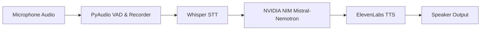

# 🎙️ VoiceAI Assistant

> **A real-time, bidirectional conversational AI voice assistant powered by OpenAI Whisper, NVIDIA NIM (Mistral-Nemotron), and ElevenLabs neural speech synthesis.**

[](https://www.python.org/)
[](https://github.com/openai/whisper)
[](https://build.nvidia.com/)
[](https://elevenlabs.io/)
[](LICENSE)

---

## 📌 Overview

**VoiceAI Assistant** is an end-to-end, ultra-low latency voice conversational pipeline designed for natural hands-free human-AI communication. It continuously listens for speech using intelligent Voice Activity Detection (VAD), transcribes audio with OpenAI Whisper, generates thoughtful, concise answers via NVIDIA NIM's Mistral-Nemotron LLM, and synthesizes expressive speech using ElevenLabs' multilingual v2 neural voice engine.

---

## 🚀 Key Features

- **🎙️ Real-time Audio Capture & VAD**: Uses PyAudio with energy-based silence detection and automatic thresholding to seamlessly start and stop listening when the user finishes speaking.
- **⚡ High-Accuracy Speech Recognition**: Employs OpenAI Whisper (`base` model) for rapid, accurate acoustic transcription with minimal latency.
- **🧠 Advanced Reasoning Engine**: Integrates NVIDIA NIM's `mistralai/mistral-nemotron` model tuned for concise, natural spoken conversation.
- **🗣️ Human-like Neural TTS**: Streams speech synthesis through ElevenLabs Multilingual v2 with fallback handling and interruption capability.
- **📊 Session Logging & Diagnostics**: Automatic daily rotated logs and audio caching for debugging and performance profiling.

---

## 🏗️ Architecture & Pipeline



1. **Audio Ingestion**: Audio recorded at 16kHz mono via PyAudio with real-time silence monitoring.
2. **Transcription**: Input WAV passed to Whisper to generate raw text prompt.
3. **Inference**: Prompt sent to NVIDIA NIM endpoint with conversational system instructions.
4. **Speech Output**: LLM text filtered and streamed to ElevenLabs API for realistic speech generation and playback.

---

## 🛠️ Tech Stack

| Component | Technology | Description |
|-----------|------------|-------------|
| **Language** | Python 3.10+ | Core application runtime |
| **Audio I/O** | PyAudio, simpleaudio, pydub | Audio streaming, silence detection, and playback |
| **Speech-to-Text** | OpenAI Whisper | Local acoustic transcription |
| **LLM Engine** | NVIDIA NIM / OpenAI API | Mistral-Nemotron reasoning model |
| **Text-to-Speech** | ElevenLabs API | Neural high-fidelity voice cloning / synthesis |
| **Config & Logging** | Dataclasses, python-dotenv | Type-safe configuration and rotated logs |

---

## 🏁 Getting Started

### Prerequisites
- Python 3.10 or higher
- Microphone and working audio output device
- Free API keys from:
  - [ElevenLabs](https://elevenlabs.io)
  - [NVIDIA NIM](https://build.nvidia.com) (or OpenAI)

### 1. Clone the Repository
```bash
git clone https://github.com/Rithish-2914/AI-VOICE-ASSISTANT.git
cd AI-VOICE-ASSISTANT
```

### 2. Set Up Virtual Environment
```bash
python -m venv .venv

# On Windows
.venv\Scripts\activate

# On macOS/Linux
source .venv/bin/activate
```

### 3. Install Dependencies
```bash
cd voiceai-main/backend
pip install -r requirements.txt
```

> **Note for Windows Users**: If PyAudio fails to install, install using precompiled wheels or run `pip install pipwin && pipwin install pyaudio`.

### 4. Configure Environment Variables
Copy `.env.example` to `.env` in `voiceai-main/backend`:
```bash
cp .env.example .env
```
Populate your credentials:
```env
ELEVENLABS_API_KEY=your_elevenlabs_api_key_here
NVIDIA_API_KEY=your_nvidia_api_key_here
```

### 5. Run the Assistant
```bash
python main.py
```
Speak into your microphone when prompted, and press `Ctrl+C` to cleanly exit.

---

## 📂 Project Structure

```
AI-VOICE-ASSISTANT/
├── .gitignore               # Ignores runtime audio, logs, and venv
├── .env.example             # Template for API keys
├── LICENSE                  # MIT License
├── README.md                # Project documentation
└── voiceai-main/
    └── backend/
        ├── config.py        # Audio, STT, LLM, and TTS configurations
        ├── main.py          # Main event loop and user interaction flow
        ├── requirements.txt # Python package dependencies
        ├── utils.py         # Audio I/O, VAD, Whisper STT, and ElevenLabs TTS
        ├── cache/           # Temporary audio buffer directory
        └── logs/            # Daily rotated diagnostic logs
```

---

## 👤 Author & Contributions

Built and maintained by **[Rithish](https://github.com/Rithish-2914)**.
- Designed the end-to-end multi-modal voice processing pipeline.
- Tuned energy-based Voice Activity Detection (VAD) thresholds for responsive turn-taking.
- Integrated low-latency streaming inference across Whisper, NVIDIA NIM, and ElevenLabs.

---

## 📄 License

This project is licensed under the [MIT License](LICENSE).